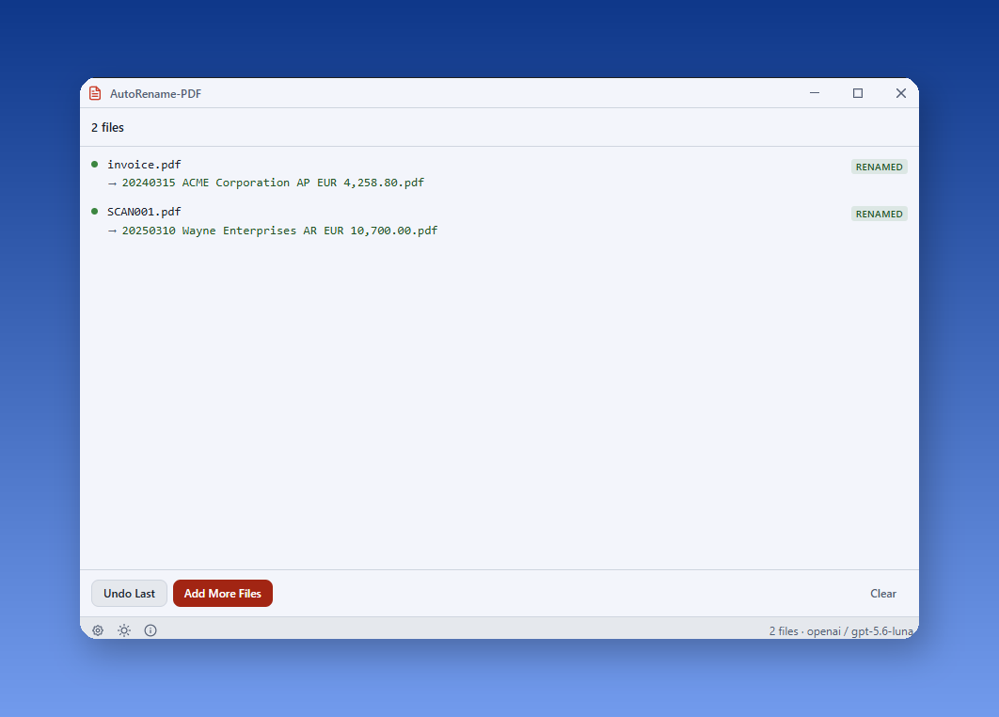
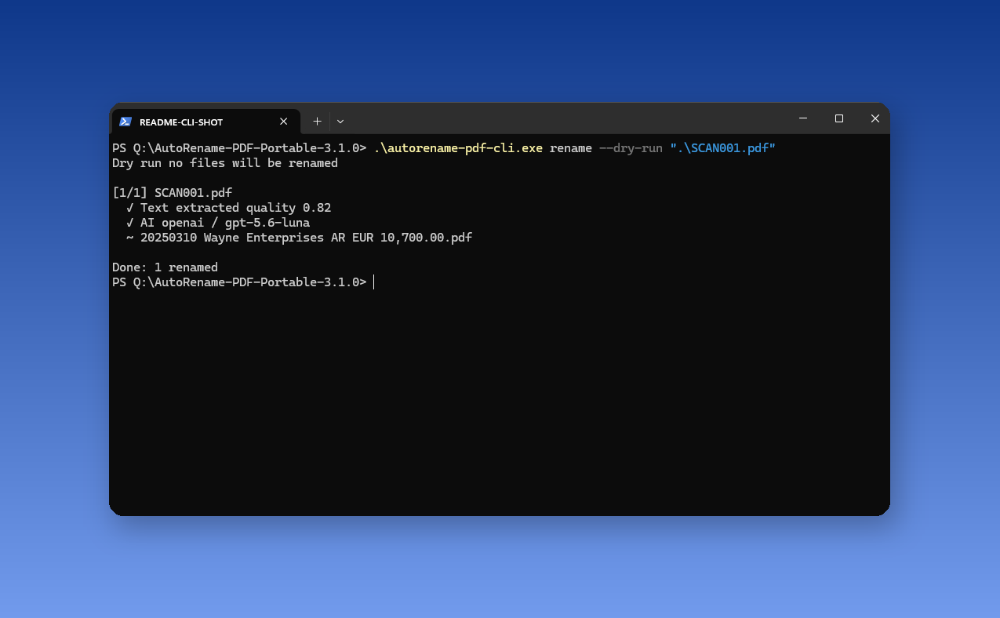

<div align="center">
  <h1>AutoRename-PDF</h1>
  <p><b>AI PDF renamer for invoices, scanned documents, and academic papers.</b><br>
  Turn PDF contents into filenames like <code>20260906 ACME AP 12,13.pdf</code>.</p>
  <p>
    <a href="https://github.com/ptmrio/autorename-pdf/releases"></a>
    <a href="https://github.com/ptmrio/autorename-pdf/blob/main/LICENSE"></a>
    <a href="https://github.com/ptmrio/autorename-pdf/releases"></a>
    <a href="https://github.com/ptmrio/autorename-pdf/releases"></a>
  </p>
</div>

Batch-rename PDFs from their contents with a Windows drag-and-drop GUI, a right-click action in Explorer, or a cross-platform Python CLI. Preview names, undo a batch, and keep vendor names consistent with fuzzy-matched aliases.

| Profile | Example filename |
|---------|------------------|
| **Business** (default) | `20260906 ACME AP 12,13.pdf` — date, counterparty, AP/AR, printed total |
| **Academic** | `20260101 Smith Nature Attention Is All You Need.pdf` — date, first author, venue, title |
| **German ER/AR** | `20260906 ACME ER 12,13.pdf` — Eingangsrechnung / Ausgangsrechnung |

Use OpenAI, Anthropic (Claude), Google Gemini, xAI (Grok), or a local LLM through Ollama. Text extraction, PaddleOCR, and vision cover digital, scanned, and image-only PDFs. Invoice codes default to **AP/AR**. Copy a recipe from [`examples/`](examples/) or edit [config.yaml.example](config.yaml.example) (the comments are the schema).

| Start here | What you need |
|----------|---------------|
| [Windows ZIP / GUI](#quick-start) | Download the release, run setup, drag in PDFs. GUI and Explorer integration are Windows-only. |
| [Offline / Ollama](#ollama-setup) | Copy [`examples/ollama-offline.yaml`](https://github.com/ptmrio/autorename-pdf/blob/main/examples/ollama-offline.yaml) from GitHub (not in the ZIP). No API key. |
| [Python CLI on macOS / Linux](#macos--linux) | Install from source. |
| [Developer setup](#developer-documentation) | Tests, architecture, builds. |



## Contents

- [Windows quick start](#quick-start) · [Common questions](#common-questions)
- [Configuration](#configuration) · [Example configs](#example-configs)
- [Usage](#usage): [GUI](#gui) · [Explorer](#context-menu) · [CLI](#command-line)
- [Company aliases](#company-name-harmonization) · [Ollama](#ollama-setup) · [macOS / Linux](#macos--linux)
- [Developer documentation](#developer-documentation) · [Support](#support-the-project) · [MIT](LICENSE)

<a id="quick-start"></a>

## Windows Quick Start: ZIP, GUI, and Explorer

1. **Download** the latest [release ZIP](https://github.com/ptmrio/autorename-pdf/releases)
2. **Extract** and run `setup.ps1` (right-click → "Run with PowerShell")
3. **Configure** — copy `config.yaml.example` to `config.yaml` if setup did not, then set provider, **model**, and key together (see the table below):
   ```yaml
   ai:
     provider: "openai"       # or anthropic, gemini, xai, ollama
     model: "gpt-5.6-luna"    # must match the provider — do not keep an OpenAI model on Anthropic/Ollama
     api_key: "your-key"      # or "${OPENAI_API_KEY}" from a .env beside this file
   company:
     name: "Your Company GmbH"
   ```
4. **Launch** `autorename-pdf-gui.exe` — or right-click any PDF in Explorer

> `setup.ps1` creates `config.yaml` from the template if missing, can add Explorer entries, and can install PaddleOCR (~500 MB) for scanned PDFs. Run it from normal PowerShell (not "Run as Administrator"). Only context-menu install/remove requests UAC.

## Common Questions

**Does it work offline?** Yes — Ollama + PaddleOCR. Copy [`examples/ollama-offline.yaml`](https://github.com/ptmrio/autorename-pdf/blob/main/examples/ollama-offline.yaml) from GitHub.

**Digital, scanned, and image PDFs?** Yes. pdfplumber always runs. Turn on `pdf.ocr` and/or `pdf.vision` (`false` / `true` / `"auto"`).

**Cost?** The tool is MIT-licensed. Cloud usage is roughly ~$0.001–0.002 per PDF depending on model. Ollama has no API fee.

**macOS or Linux?** CLI yes. GUI and Explorer are Windows-only.

**Preview or undo?** GUI **Preview names**, CLI `--dry-run`, then undo. Already-correct names are skipped.

**Research papers?** `profile: academic`, `rename --profile academic`, or [`examples/academic.yaml`](https://github.com/ptmrio/autorename-pdf/blob/main/examples/academic.yaml).

## Configuration

The schema lives in [config.yaml.example](config.yaml.example). Copy it to `config.yaml`. Any string may use `${VAR_NAME}`; a `.env` next to the config is loaded automatically (see `.env.example`).

| Provider | Flagship | Budget |
|----------|----------|--------|
| OpenAI | `gpt-5.6-sol` | `gpt-5.6-luna` |
| Anthropic | `claude-sonnet-5` | `claude-haiku-4-5` |
| Gemini | `gemini-3.8-flash` | `gemini-3.5-flash-lite` |
| xAI | `grok-4.6` | `grok-4.3` |
| Ollama | `qwen3:8b` | `qwen3:4b` / `llama3.2:3b` |

<a id="example-configs"></a>

### Example configs

Copy a file from [`examples/`](https://github.com/ptmrio/autorename-pdf/tree/main/examples) over `config.yaml`, then set your API key and company name. Those recipes are in the GitHub repo, not in the Windows ZIP (the ZIP ships `config.yaml.example` only).

| Recipe | What it changes |
|--------|-----------------|
| [academic.yaml](examples/academic.yaml) | `profile: academic` |
| [er-ar.yaml](examples/er-ar.yaml) | `incoming_invoice: ER` (Eingangsrechnung) |
| [ollama-offline.yaml](examples/ollama-offline.yaml) | `provider: ollama`, `ocr: true`, empty API key |
| [vision-cloud.yaml](examples/vision-cloud.yaml) | `vision: true`, no PaddleOCR |
| [invoice-id.yaml](examples/invoice-id.yaml) | printed total **and** invoice number |

```yaml
# Academic for one run, without saving config
# .\autorename-pdf-cli.exe rename --profile academic paper.pdf

profile: academic
```

```yaml
# German bookkeeping codes (also examples/er-ar.yaml)
pdf:
  incoming_invoice: ER   # Eingangsrechnung
  outgoing_invoice: AR   # Ausgangsrechnung
```

`rename --profile` overrides `profile` for that run. Built-ins are `business` and `academic`. Overlays go under `profiles:` — see comments in `config.yaml.example`. `config validate` checks every declared profile.

## Usage

<a id="gui"></a>

### Windows GUI: Drag, Preview, and Rename

Launch `autorename-pdf-gui.exe` and drop PDF files or folders. **Preview names** (secondary) inspects proposed names; **Rename** applies them. Undo reverses the last batch that actually renamed files. The titlebar toggles light/dark; Settings has System / Light / Dark (stored in the app, not in `config.yaml`).

Settings is a read-only inspector of `config.yaml`. Validate or open the folder there; edit the YAML to change behavior.

<a id="context-menu"></a>

### Rename PDFs from Windows Explorer

After setup installs context menus:

- **Single PDF** → `Auto Rename PDF`
- **Folder** → `Auto Rename PDFs in Folder`
- **Folder background** → `Auto Rename PDFs in This Folder`

Windows 11: under "Show more options" (Shift+F10).

<a id="command-line"></a>

### Command Line: Batch Rename and JSON

PowerShell in the extracted ZIP folder (note `.\` and `rename` before flags). From source use `python autorename-pdf.py` after [installing](#macos--linux).



```powershell
.\autorename-pdf-cli.exe "C:\path\to\file.pdf"
.\autorename-pdf-cli.exe rename --dry-run "C:\path\to\folder"
.\autorename-pdf-cli.exe rename --recursive "C:\path\to\folder"
.\autorename-pdf-cli.exe undo
.\autorename-pdf-cli.exe rename --provider anthropic --model claude-sonnet-5 "file.pdf"
.\autorename-pdf-cli.exe rename --profile academic "paper.pdf"
.\autorename-pdf-cli.exe rename --vision --ocr "scanned.pdf"
.\autorename-pdf-cli.exe rename --output json "C:\path\to\folder"
```

JSON includes `total` / `renamed` / `skipped` / `failed`, `batch_id`, and per-file `profile` plus raw `fields`. Files whose names already match are skipped.

<details>
<summary><strong>Full CLI reference</strong></summary>

#### Subcommands

| Subcommand | Description |
|------------|-------------|
| `rename` | Rename PDF files (default if omitted) |
| `undo` | Reverse file renames using the undo log |
| `config show` | Display current configuration (API keys redacted) |
| `config validate` | Validate configuration and report issues |
| `config inspect` | JSON snapshot combining show + validation (GUI) |

#### Rename options

| Flag | Description |
|------|-------------|
| `--dry-run` | Show names without renaming |
| `--recursive`, `-r` | Process folders recursively |
| `--provider` / `--model` | Override config for this run |
| `--vision` / `--ocr` / `--text-only` | Extraction overrides |
| `--profile` | Extraction profile id (overrides config) |
| `--output`, `-o` | `text` or `json` |
| `--quiet`, `-q` / `--verbose`, `-v` | Logging |
| `--config` | Path to `config.yaml` |

#### Undo options

| Flag | Description |
|------|-------------|
| `--list` | List undo batches |
| `--batch <id>` | Undo one batch |
| `--all` | Undo every batch |

#### Exit codes

| Code | Meaning |
|------|---------|
| 0 | Success |
| 1 | General error |
| 2 | Usage error |
| 3 | Configuration error |
| 4 | No files found |
| 5 | Partial failure |
| 10 | AI provider error |
| 11 | Authentication error |

</details>

## Company Name Harmonization

Copy [harmonized-company-names.yaml.example](harmonized-company-names.yaml.example) to `harmonized-company-names.yaml`:

```yaml
ACME:
  - "ACME Corp"
  - "ACME Inc."
```

Jaro-Winkler matching maps OCR typos to the canonical name. Academic profile skips this file.

**Tip:** Paste your filenames into an LLM with *"Create a harmonized-company-names.yaml mapping these variations to standardized names."*

<a id="ollama-setup"></a>

## Offline PDF Renaming with Ollama and PaddleOCR

Copy [`examples/ollama-offline.yaml`](https://github.com/ptmrio/autorename-pdf/blob/main/examples/ollama-offline.yaml) from GitHub (not in the ZIP). Download models **before** going offline; keep Ollama running.

```powershell
winget install -e --id Ollama.Ollama
ollama pull qwen3:4b
```

| Model | VRAM | Best for |
|-------|------|----------|
| `qwen3:8b` | ~5 GB | Most text PDFs |
| `qwen3-vl:8b` | ~6 GB | Scanned/image PDFs (`vision: true`) |
| `qwen3:4b` | ~3 GB | Budget GPU |
| `llama3.2:3b` | ~2.5 GB | Minimal hardware |

Windows 10 22H2+ or Windows 11. GPU with 6+ GB VRAM recommended (CPU-only works with 16+ GB RAM). See [ollama.com](https://ollama.com).

<a id="macos--linux"></a>

## Python CLI on macOS / Linux

CLI: Python 3.11+. GUI and context menu: Windows-only.

```bash
git clone https://github.com/ptmrio/autorename-pdf.git
cd autorename-pdf
python -m venv venv
source venv/bin/activate
pip install -r requirements.txt
cp config.yaml.example config.yaml   # or cp examples/academic.yaml config.yaml
python autorename-pdf.py rename --dry-run invoice.pdf
```

PaddleOCR venv and logs default to `~/.local/share/autorename-pdf/`.

## Support the Project

- ⭐ [Star this repo](https://github.com/ptmrio/autorename-pdf)
- 💖 [GitHub Sponsors](https://github.com/sponsors/ptmrio)
- ☕ [Ko-fi](https://ko-fi.com/spqrk)
- 💛 [PayPal](https://paypal.me/realSPQRK)

Also: [PhraseVault](https://phrasevault.app) — text expander by the same developer.

Thank you [@claus82](https://github.com/claus82).

<a id="developer-documentation"></a>

## Developer Documentation

<details>
<summary><strong>Setup, architecture, tests, and builds</strong></summary>

Python 3.11+ (CLI). Optional OCR embed: Python 3.13.15, PaddlePaddle 3.3.1 / PaddleOCR 3.7.0 (`PP-OCRv6_small` defaults).

```bash
pip install -r requirements.txt -r requirements-dev.txt
cp config.yaml.example config.yaml
python -m ruff check .
pytest tests/ -v --cov
pytest tests/ --run-live --provider ollama -v
python build.py --nosign
```

Functional Python; `_*.py` modules are internal. OpenAI/Anthropic use native structured parse; Instructor is only for Gemini, xAI, and Ollama. Agent notes: `AGENTS.md` / `CLAUDE.md`.

Contributions: issues and forks welcome; we are not taking PRs right now.

</details>

---

MIT License — Made by [Gerhard Petermeir, SPQRK Web Solutions](https://github.com/ptmrio)
